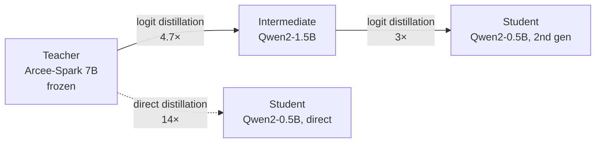

<div align="center">

# Explain Like I'm a 500M-Parameter Model

**Sequential LLM knowledge distillation: shrink a 7B model to 0.5B through a 1.5B "teacher assistant", and the small model ends up better than one distilled directly.**

[Report](Report.pdf) &nbsp;·&nbsp; [How it works](#how-it-works) &nbsp;·&nbsp; [Results](#results) &nbsp;·&nbsp; [Run it](#run-it)


</div>

## How it works, in one page

- **The problem:** knowledge distillation trains a small student to imitate a large teacher, but when the capacity gap is large (here 14×, 7B to 0.5B), the student can't follow and quality drops sharply.
- **What this does:** it splits the jump into two steps. The 7B teacher distills into a 1.5B intermediate, which then distills into the 0.5B student. A **parallel** variant, where both students learn from the 7B teacher at once, is the comparison.
- **What was found:** on a held-out test set, the sequentially distilled 0.5B model beats the directly distilled one on every metric, and even beats the 7B teacher on perplexity and top-1 accuracy (attributed to specializing on the training distribution).

> [!NOTE]
> **A University of Michigan group project** by Devashish Juyal, Erik Nielsen, Rohan Singh and Krish Kapoor. The project was motivated by Keypoint-based Progressive Distillation (KPOD); for tractability, the final experiments use **logit-level distillation** (matching the teacher's token distributions) rather than full keypoint alignment. The `KPOD/` folder holds the earlier, fuller KPOD implementation work.

---

## How it works



1. **Teacher.** Arcee-Spark (7B) is frozen and serves only as a source of soft targets.
2. **Stage 1.** Qwen2-1.5B learns to match the teacher's token-level output distribution (KL divergence on temperature-scaled logits, mixed with the usual cross-entropy).
3. **Stage 2.** Qwen2-0.5B learns from the trained 1.5B model, not from the 7B teacher.
4. **Baseline.** A second Qwen2-0.5B learns directly from the 7B teacher with the same data and hyperparameters.

All runs use the FineTome-100k instruction dataset and are evaluated on a held-out test set.

## Results

From Table 2 of the [report](Report.pdf), on the held-out test set with the same data and hyperparameters for every model:

| Model | Perplexity ↓ | Avg loss ↓ | Top-1 ↑ | Top-5 ↑ | KL div ↓ |
|---|---|---|---|---|---|
| Arcee-Spark 7B (teacher) | 2.89 | 1.063 | 75.68% | 92.73% | – |
| Qwen2-0.5B, direct | 2.28 | 0.823 | 78.30% | 93.77% | 6522.56 |
| Qwen2-1.5B, intermediate | 1.97 | 0.676 | 81.30% | 95.48% | 6379.52 |
| **Qwen2-0.5B, sequential** | **1.76** | **0.564** | **85.05%** | **96.31%** | **6072.96** |

Against direct distillation, the sequential 0.5B model has **22.8% lower perplexity**, **31.5% lower average loss**, top-1 accuracy **85.05% vs. 78.30%**, and **6.9% lower KL divergence** from the teacher. The report also compares responses qualitatively across explanation, coding and comparison prompts.

## Features

- **Sequential chain runner** (`SequentialDistillation/run_sequential_chain.py`): teacher → 1.5B → 0.5B in one command, with the models, sample count and sequence length as flags.
- **Logit and hidden-state distillation** scripts adapted from Arcee AI's [DistillKit](https://github.com/arcee-ai/DistillKit), plus a DPO variant. Hidden-state sequential distillation is currently disabled in the chain runner.
- **Parallel distillation** scripts and a notebook in `ParallelDistillation/`.
- **KPOD experiments** in `KPOD/`: rationale generation (including GSM8K), token weighting and training at several scales, with SLURM jobs for a cluster.

## Run it

**Prerequisites:** Python 3 with a CUDA GPU. The models are large: plan on a GPU with 24 GB of memory or more.

```bash
git clone https://github.com/juyal-devashish/ELI500Model-Sequential-Distillation.git
cd ELI500Model-Sequential-Distillation
pip install -r requirements.txt
cd SequentialDistillation
python run_sequential_chain.py --help
python run_sequential_chain.py --base-output-dir ./results --num-samples 1000 --max-length 1024
```

Defaults: teacher `arcee-ai/Arcee-Spark`, intermediate `Qwen/Qwen2-1.5B`, student `Qwen/Qwen2-0.5B`. `--teacher`, `--student-a` and `--student-b` change them.

## Repository layout

```
SequentialDistillation/   the sequential chain runner and DistillKit-based logit, hidden-state and DPO scripts
ParallelDistillation/     parallel distillation scripts and notebook
KPOD/                     keypoint-based progressive distillation experiments, rationale generation, SLURM jobs
Report.pdf                the final report, with methods, results and qualitative comparisons
Project-Proposal.pdf      the original proposal
KPOD.pdf                  the KPOD paper this project builds on
```

## Acknowledgments

- Built on [DistillKit](https://github.com/arcee-ai/DistillKit) by Arcee AI (Apache 2.0; its license is kept in `SequentialDistillation/LICENSE`).
- Models: [Qwen2](https://huggingface.co/Qwen) and [Arcee-Spark](https://huggingface.co/arcee-ai/Arcee-Spark). Dataset: [FineTome-100k](https://huggingface.co/datasets/mlabonne/FineTome-100k) by mlabonne.
